<picture>
  <source media="(prefers-color-scheme: dark)" srcset="./assets/banner-dark.svg">
  
</picture>

  
  
  

## Обо мне

Junior Go-разработчик, пишу бэкенд. Больше всего мне интересна надёжность:
чтобы при сбоях деньги не списывались дважды, события не терялись, а сервис
переживал выкатку и падение зависимостей.

Работаю так: сначала воспроизвожу поломку, потом чиню её и сравниваю замеры
до и после. Каждый такой эксперимент описываю прямо в репозитории.

Ищу работу или стажировку Go-разработчиком.

## Проекты

<table>
  <tr>
    <td width="50%" valign="top">

### [microservice-architecture](https://github.com/xdtqwd/microservice-architecture)

Сервис заказов и оплаты. Воспроизводил типичные поломки распределённой
системы и чинил их с замерами до и после.

- Двойное списание: 2 → 1 благодаря идемпотентности до самого провайдера
- Transactional outbox и inbox: события не теряются и не дублируются
- Kubernetes: выкатка и вывод узла из кластера без ошибок
- Индексы и keyset-пагинация: 2391 мс → 0.09 мс

`Go` `PostgreSQL` `Kafka` `Redis` `Kubernetes` `k6`

</td>
    <td width="50%" valign="top">

### [alfa-credit](https://github.com/xdtqwd/alfa-credit)

Кредитный кабинет для малого бизнеса, сделан на Альфа Хак 2026. Путь заявки
от расчёта платежа до выдачи денег, кабинеты клиента и банка.

- Двухуровневая анкета: расчёт без входа, затем вход через Госуслуги (имитация) и полный скоринг
- Решение с объяснением: одобрение, контрпредложение или отказ с причинами
- Kafka через outbox, отдельные роли api и worker, rate limiting
- e2e-тесты и демо-видео

`Go` `PostgreSQL` `Kafka` `Docker`

</td>
  </tr>
</table>

## Что умею

- **Go:** REST API, слоистая архитектура, context и таймауты, graceful shutdown, горутины и каналы
- **PostgreSQL:** транзакции и уровни изоляции, индексы по `EXPLAIN ANALYZE`, keyset-пагинация, миграции на goose
- **Kafka:** transactional outbox, inbox-дедупликация, DLQ, ретраи с backoff
- **Надёжность:** идемпотентность, circuit breaker, singleflight, сверка с внешним провайдером
- **Kubernetes:** пробы, HPA, PodDisruptionBudget, выкатка без потерь
- **Тесты:** testcontainers, race detector, мутационное тестирование, нагрузка на k6
- **Наблюдаемость и CI:** Prometheus, Grafana, алерты, GitHub Actions, golangci-lint, govulncheck

## Стек

<picture>
  <source media="(prefers-color-scheme: dark)" srcset="https://skillicons.dev/icons?i=go,postgres,redis,kafka,docker,kubernetes,prometheus,grafana,githubactions,git&amp;theme=dark">
  
</picture>
